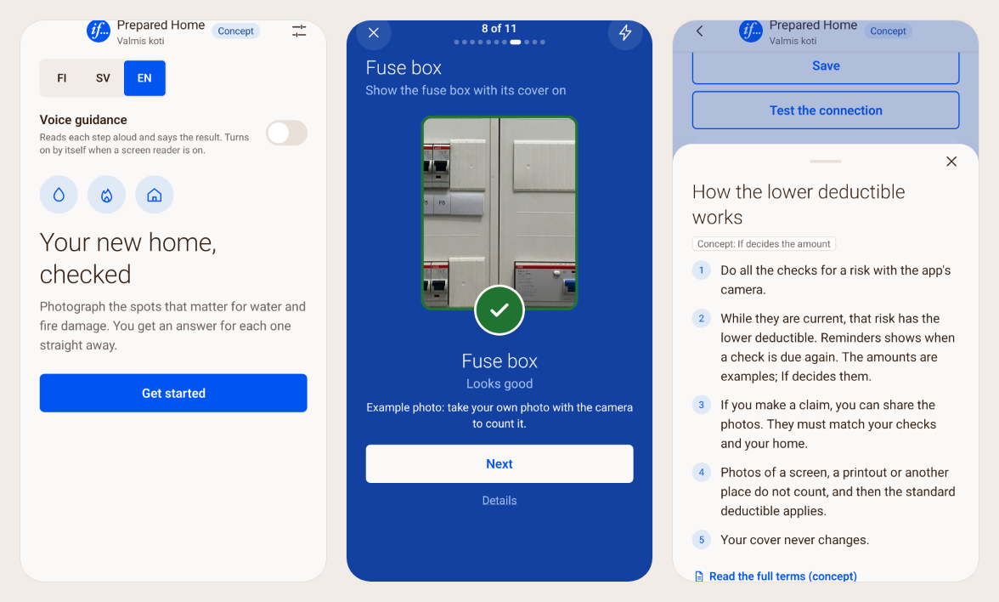

# Prepared Home (Valmis koti)

A voluntary moving-day check-up for your home, inside the home insurance app. You photograph about a dozen everyday spots that cause water and fire damage; a vision model checks each photo against fixed criteria, and while a risk's checks are current its deductible could be lower (a concept: the insurer decides). Built for If's challenge at JunctionX Turku 2026; not a live If service.



**Live demo:** https://preparedhome.demo.wicflow.com. The app runs in a virtual iPhone; **Play the guided tour** (or open `/?tour=1`) for a 90-second walkthrough, or use the phone freely. The app itself is at `/app`, and opens straight into a partly checked example flat at `/app/?example=flat`. On the web, a demo camera shows licensed example photos whose results were recorded once (`npm --prefix server run record:scenes`), so the demo works the same for everyone, even without an API key.

## Run it
```bash
npm run setup                 # installs the tools, the engine, the server and the app
npm run check                 # formatting, lint, typecheck and all tests (offline)
npm --prefix server run dev   # the API on http://localhost:8787
```
Then run `npm --prefix app run web` in a second terminal, or `npm --prefix app start` for Expo Go on a phone. With no `ANTHROPIC_API_KEY` in `.env.local` the server runs offline: the recorded sample photos still work, and other photos answer "retake".

## Architecture
One data-flow diagram, with every part linked to its folder: [`docs/ARCHITECTURE.md`](docs/ARCHITECTURE.md).
- **`packages/engine`:** pure TypeScript rules shared by the server and the app. It holds the 14 checks with fixed criteria and their If-terms clauses, plus the verdicts, status per risk, deductible preview, reminders, Home Card and claim decision. No dependencies, no I/O.
- **`server`:** a small stateless Node API. It verifies each photo's SHA-256, asks the vision model about the check's criteria (one `VisionProvider` interface: live, recorded or offline), applies the engine's rules and returns the outcome. It has per-IP and daily spend limits and stores nothing.
- **`app`:** an Expo app for Android, iOS and web. State stays on the device, and status is computed locally with the engine.
- **The model never decides.** It only answers "is this visible, and is it in order?". Verified, Retake and Fix first, the deductible and the claim decision are deterministic code.
- **Anti-cheat:** photos of screens or printouts are always "Retake". Only in-app camera photos taken from two angles count toward the lower deductible. At a claim, shared photos must match the recorded fingerprints.

## Folder map
```
packages/engine/   rules, check definitions, If clause data (generated), example homes, tests
server/            API, vision providers, limits, FMI frost forecast, photo evals
app/               Expo app: screens, ui, state, photo pipeline, i18n (src/prepared-home)
landing/           the page at /: the app in a phone frame and a QR code
deploy/            compose files and the pack script
release/artifact/  generated by deploy/pack.sh: the server bundle and web build the image copies
docs/              architecture, implementing at If, accessibility, hosting, native builds
```

## Where the key logic lives
- `packages/engine/src/checks.ts`: the 14 checks, their criteria, and the If clause each one relates to.
- `packages/engine/src/verdict.ts`, `status.ts`, `reminders.ts`, `homeCard.ts` and `adjuster.ts`: in order, the verdicts and due dates; status and the deductible preview; reminders; the Home Card; the claim decision.
- `server/src/vision/`: the model behind one interface, with the instructions and output validation.
- `app/src/prepared-home/screens/check/`: the capture flow (camera, second angle, scan, check or X with tips).

## Tests
- **`npm run check`:** 87 engine and 64 server tests, offline with mocked model calls, plus Maestro flows for the phone in `app/maestro/`.
- **Photo evals** (`server/eval`) gate every model or instruction change. These numbers are for `claude-sonnet-5-5`, the default:
  - **Gate set:** 24 licensed photos, hand-labelled. **24/24, with no false "Verified".**
  - **Large set** (`server/eval/large`): 414 licensed photos across all 14 checks, including 100 hard cases. It agrees with independent draft labels on **87.4%**, with 13 false "Verified".
    - The labels were drafted by `claude-opus-5-5` with separate instructions, in two passes that agree on 87%. The team reviews them in `review.html`, and `rescore.ts` then reports accuracy against the reviewed labels.
    - Comparison with draft labels: Opus 5.5 89.1% (it also wrote the labels), Haiku 5.5 77.5%. Sonnet's answer changed on 3.9% of photos between two runs.

## What's real and what's mocked
- **Real:** the vision checks (Claude API); If's public home-insurance terms (OMA 200.27, 28 clauses verified word for word in fi, sv and en) quoted per check; the anti-cheat rules; the FMI frost forecast; photo fingerprints; voice guidance and screen-reader support ([`docs/ACCESSIBILITY.md`](docs/ACCESSIBILITY.md)).
- **Concept or mocked:** the deductible amounts ("Concept: If decides the amount"); the damage report and the claims handler's view (nothing is sent to If); the example homes.
- **Moving it into If:** what's ready, what If decides, and the integration points are in [`docs/IMPLEMENTING-AT-IF.md`](docs/IMPLEMENTING-AT-IF.md).

## Data sources and licences
- **If's home insurance terms:** public documents, quoted per check in Finnish, Swedish and If's official English translation (Finnish prevails).
- **Photos:** Wikimedia Commons, under CC0, public domain, CC BY and CC BY-SA. Credits are in `server/eval/photos/README.md` and `server/eval/large/README.md`, and sample credits are shown in the app.
- **Weather:** Finnish Meteorological Institute open data (CC BY 4.0).
- **Branding:** the If logo and name are used for this concept for If, pending If's written consent. One switch turns the neutral version back on (`app/src/prepared-home/brand.ts`).

All code in this repo was written during the event.
