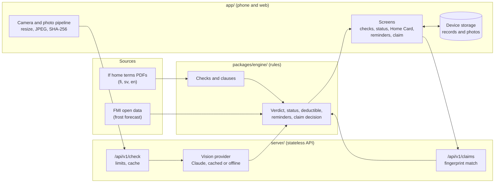

# Architecture

Three small parts share one set of rules. The app takes the photo, the server asks the vision model what it sees, and the engine decides everything else in plain, tested code.

## The parts
| Part | What it does | Where |
|---|---|---|
| **Sources** | If's public home terms, quoted verbatim per check in Finnish, Swedish and If's official English. A generator turns them into typed data (marked as generated) | [`packages/engine/tools/gen-clauses.mjs`](../packages/engine/tools/gen-clauses.mjs), [`packages/engine/src/data/clauses.ts`](../packages/engine/src/data/clauses.ts) |
| **Checks** | The 14 checks: fixed criteria, the If clause each one relates to, coach lines and fix hints | [`packages/engine/src/checks.ts`](../packages/engine/src/checks.ts) |
| **Rules** | Turns the model's answers into Verified, Retake or Fix first, then works out status per risk, the deductible preview, reminders, the Home Card and the claim decision. No I/O; the same code runs in the server and the app | [`packages/engine/src/rules.ts`](../packages/engine/src/rules.ts) |
| **Photo pipeline** | The in-app camera; resizes to at most 1600 px; JPEG; SHA-256 fingerprint of the exact bytes sent | [`app/src/prepared-home/photoPipeline.ts`](../app/src/prepared-home/photoPipeline.ts) |
| **Check API** | Verifies the fingerprint, applies per-IP and daily spend limits, asks the vision provider, applies the rules, and returns the outcome. Stores nothing | [`server/src/routes/`](../server/src/routes/), [`server/src/limits.ts`](../server/src/limits.ts) |
| **Vision provider** | One interface with three implementations: Claude (live), recorded results (cache) and offline. The model answers only "is this visible / is this in order", and also flags photos of screens or printouts | [`server/src/vision/`](../server/src/vision/) |
| **Claim check** | Hashes shared photos in memory, compares them with the recorded fingerprints, and returns the claims handler's view | [`server/src/routes/v1.ts`](../server/src/routes/v1.ts) |
| **Screens** | Onboarding, the check flow, status, the Home Card, reminders, settings, the damage report and the claims handler view | [`app/src/prepared-home/screens/`](../app/src/prepared-home/screens/) |
| **Device storage** | Homes, check records and photo copies stay on the phone or in the browser | [`app/src/prepared-home/storage.ts`](../app/src/prepared-home/storage.ts) |

## Three rules that keep it honest
1. **The model never decides.** It reports what it sees per criterion; the verdict, status, deductible and claim decision are deterministic code with unit tests.
2. **Only in-app camera photos count.** Gallery and example photos are shown but never count toward the lower deductible. Photos of screens or printouts are always "Retake".
3. **Every model change is measured.** A fixed set of licensed photos runs through the model, and the gate refuses a model that is less accurate or gives a false "Verified" ([`server/eval/`](../server/eval/)).

## Running and deploying
- **Locally:** the commands are in the [README](../README.md).
- **Production:** one container serves the API, the web app (`/app`) and the landing page (`/`) ([`DEPLOY.md`](../DEPLOY.md), [`deploy/`](../deploy/)).
- **Native builds:** EAS ([`docs/NATIVE-BUILDS.md`](NATIVE-BUILDS.md)).
